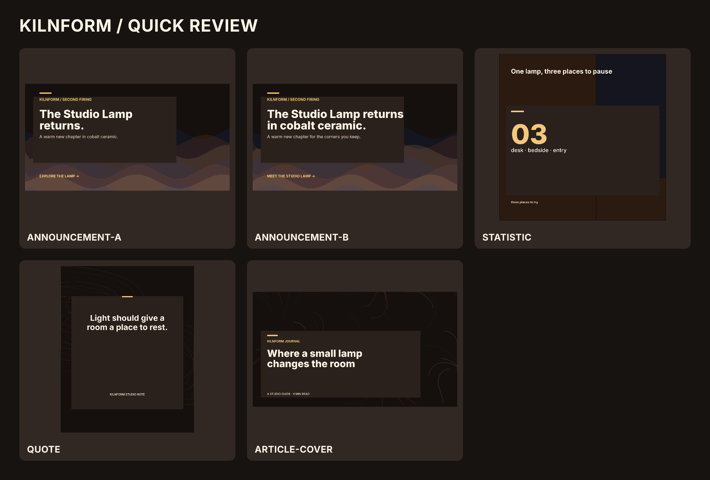

# Glyphkiln designer day — capability stress test

**Status:** Internal proof, awaiting client and live-device review. The brief and
all product claims are fictional. Nothing in this folder is a published ad.



## The brief

Act as Kilnform's senior graphic designer during a release day for a fictional
second batch of its cobalt ceramic Studio Lamp. The work queue begins with
small social and editorial jobs, then adds a client copy revision, a three-format
photo campaign, a six-slide organic carousel, and a custom process diagram.
Use the existing local Kilnform product photo and symbol as exact pinned assets.
The point is to judge finished communication, revision effort, and delivery
proof—not only whether files render.

## Work plan, basic to advanced

| Level | Everyday designer job                                   | Deliverable and stress signal                                                             | Acceptance test                                                                    | This run                                                                                       |
| ----- | ------------------------------------------------------- | ----------------------------------------------------------------------------------------- | ---------------------------------------------------------------------------------- | ---------------------------------------------------------------------------------------------- |
| 1     | Turn a supplied brief into a brand-aligned announcement | Two LinkedIn announcement options; one longer client-requested headline                   | Select the stronger hierarchy and retain both revisions                            | **Done.** B is selected; A keeps an `ORPHAN_LINE` warning as revision evidence.                |
| 2     | Make routine supporting graphics                        | Number card, studio quote, editorial cover                                                | Consistent palette, no invented testimonial or performance statistic, legible copy | **Done.** Claims are explicitly fictional brief content.                                       |
| 3     | Adapt a hero image across channels                      | LinkedIn landscape, Instagram square and portrait from one photo and mark                 | Product recognizable in every crop; text bounds and sampled contrast pass          | **Done with reservations.** Crops and contrast pass; tiny blue mark needs brand review.        |
| 4     | Build a carousel as a sequence                          | Six TikTok organic Photo Mode slides; hook, context, evidence, explanation, recap, action | Sequence review, alt text, source note, phone-size visual proof                    | **Technical pass; creative hold.** The text-only template cannot show the lamp in this format. |
| 5     | Draw a bespoke explanation                              | Four-stage process diagram using the public Scene Kernel                                  | Reading order, no text occlusion, exact SVG/PNG reproduction                       | **Done.** Maker must verify process details.                                                   |
| 6     | Handle broken inputs                                    | Overlong text, unsupported visible RTL, wrong photo hash                                  | Fail with explicit, stable errors                                                  | **Done.** All three controls pass; all three mutations fail as expected.                       |
| 7     | Hand off                                                | Source designs, exact assets, proofs, manifests, captions, alt text and review status     | A second run reproduces every byte                                                 | **Done for Core outputs.** App approval and durable export remain a separate exercise.         |

### Next stress rounds

1. **Real brand intake:** replace the fictional brief with an owner-approved
   product specification, rights-cleared image and logo variants, pricing/source
   ledger, and three distinct brand snapshots. Measure the time to set up and
   revise each direction.
2. **App workflow:** with PostgreSQL, storage, worker, and campaign gate
   configured, create the same work in the editor; save immutable revisions,
   compare the two announcement options, review, approve, queue exports, and
   verify a handoff archive. Record clicks, elapsed time, and where API/SDK work
   is still required.
3. **Localization and format pressure:** author Thai copy with protected phrases,
   try longer English copy, edge focal crops, both light and dark photographic
   treatments, and square/portrait/story exports. Inspect at delivered widths.
4. **Production boundary:** explicitly request print PDF/CMYK, layered editable
   source, and a product-photo organic carousel. Record whether Glyphkiln can
   produce them natively, needs a separate tool, or cannot currently serve the
   brief. Do not relabel an SVG/PNG proof as one of those deliverables.

## Results and design judgment

The [external portfolio benchmark](portfolio-benchmark.md) compares these
boards with specific Behance and Dribbble projects. The campaign is a usable
first direction, the product-led carousel remains on creative hold, and the
diagram is the strongest advanced graphic after subject-matter review.

Core rendered **14 semantic designs** and the Scene Kernel rendered **one
diagram**. The semantic set produced 28 exact SVG/PNG outputs with manifests;
the diagram produced two more. The selected announcement, three routine
graphics, three image adaptations, and all six carousel slides have no blocking
render issues. The carousel sequence passes review with one retained
`COMPOSITION_RHYTHM_REVIEW` advisory because all slides share one registered
composition variant. Alternating modes, content density, and deterministic
pattern rails create a visible rhythm within that constraint.

The first announcement remains in the review board so its isolated final word
can be compared to selected option B. I revised the carousel copy after Core
reported orphan lines; the final six slides have no text-quality warnings.
The three photo formats were cropped individually and their sampled text
contrast passed. I removed optional tiny support lines from those canvases and
placed the product explanation in [publishing copy](campaign/publishing-copy.json)
because the LinkedIn raster had scaled supporting text below practical phone
readability. This was a design decision from viewing the work at feed size, not
a Core validation failure.

The **carousel is not approved as a standalone product placement guide**. Its
registered organic template is typography-first and has no photo asset role, so
the six slides never show the lamp even though the final slide asks viewers to
meet it. It can be a companion editorial sequence beside the photo campaign;
a product-led organic carousel needs another supported composition. The small
cobalt raster mark also loses visibility on the dark photographic background.
Core measures text contrast, not logo visibility or product-detail visibility;
the dark treatment dims the cobalt glaze. These require a lighter approved mark
and source/treatment review before a client handoff.

The process diagram is visually clear at its 1200 × 675 target size. Its
schematic stages are an art-direction proof, not a verified manufacturing or
electrical-safety claim. See the [scene review](scene/scene-review.md).

### Product priorities exposed by the run

1. **Product imagery in organic carousels:** offer a reviewed photo-capable
   composition for the 3:4 working canvas, while preserving the strict
   sequence and delivery-profile contracts.
2. **Feed-size type guidance:** expose delivered font sizes as an authoring
   warning. Measured contrast alone accepted optional copy that became too
   small when a landscape graphic was viewed at phone width.
3. **Logo and subject visibility proof:** review the admitted raster mark and
   product after image treatment. The current 5 × 5 proof measures text
   contrast, not the identity mark or whether the cobalt glaze still reads.
4. **Scene access for designers:** the custom diagram succeeded through Core's
   Scene Kernel, but the App editor cannot author or review Scene documents.

## Review and source files

| Area                        | Review board or record                                                                                                                      | Source and outputs                                                    |
| --------------------------- | ------------------------------------------------------------------------------------------------------------------------------------------- | --------------------------------------------------------------------- |
| Quick graphics and revision | [Board](boards/quick-review.png)                                                                                                            | [Design JSON](designs/) · [SVG/PNG and manifests](outputs/)           |
| Photo campaign              | [Board](boards/campaign-review.png) · [publishing copy](campaign/publishing-copy.json)                                                      | [Design JSON](designs/) · [SVG/PNG and manifests](outputs/)           |
| Six-slide carousel          | [Board](boards/carousel-review.png) · [sequence review](carousel/sequence-review.json) · [delivery sidecar](carousel/delivery-sidecar.json) | [Design JSON](designs/) · [SVG/PNG and manifests](outputs/)           |
| Process diagram             | [PNG](scene/how-the-light-is-made.png) · [review](scene/scene-review.md)                                                                    | [Scene JSON](scene/scene.json) · [SVG and manifests](scene/)          |
| Controlled failures         | [Probe notes](probes/README.md) · [results](probes/probe-results.json)                                                                      | [Probe runner](probes/run-probes.mjs)                                 |
| Full semantic proof         | [Review record](review-record.json)                                                                                                         | Per-case crop, safe area, font, contrast, output hash and fingerprint |

The carousel uses the repository's `tiktok-organic-photo` delivery profile.
Its 1080 × 1440 canvas and overlay are Glyphkiln working guidance, not a claim
of a universal TikTok organic requirement. The selected profile is for native
Photo Mode; TikTok's [Content Posting API media guide](https://developers.tiktok.com/docs/en/content-posting-api-media-transfer-guide)
lists WebP and JPEG for images, so that separate path requires explicit media
conversion and publishing proof. No platform post or API upload was performed
here.

## Reproduce

From the repository root on the pinned Node/npm toolchain:

```sh
npm run build --workspace @glyphkiln/core
node Deliverables/designer-stress-test-2026-09-25/generate.mjs --verify
node Deliverables/designer-stress-test-2026-09-25/scene/build.mjs --verify
node Deliverables/designer-stress-test-2026-09-25/probes/run-probes.mjs --verify
```

The `--verify` runs compare regenerated bytes with this folder. The generation
scripts accept only local repository assets and pinned font bytes, use explicit
seeds and timestamps, and never fetch during rendering.

## Repository verification

After the artifacts were generated, the required root gates passed: `npm run
build`, `npm run typecheck`, `npm run lint`, `npm test`, and `npm run
test:coverage`. Core passed 393 tests, the App passed 530 with five skips, and
the example consumer passed four. Statement coverage was 86.99% for Core and
87.61% for the App; the example consumer reached 92.27% line coverage. The
three artifact `--verify` commands and folder-level Prettier check also passed.
The package-consumer test needed normal npm cache access in this sandbox; its
first attempt with a fresh temporary cache timed out during dependency install.
