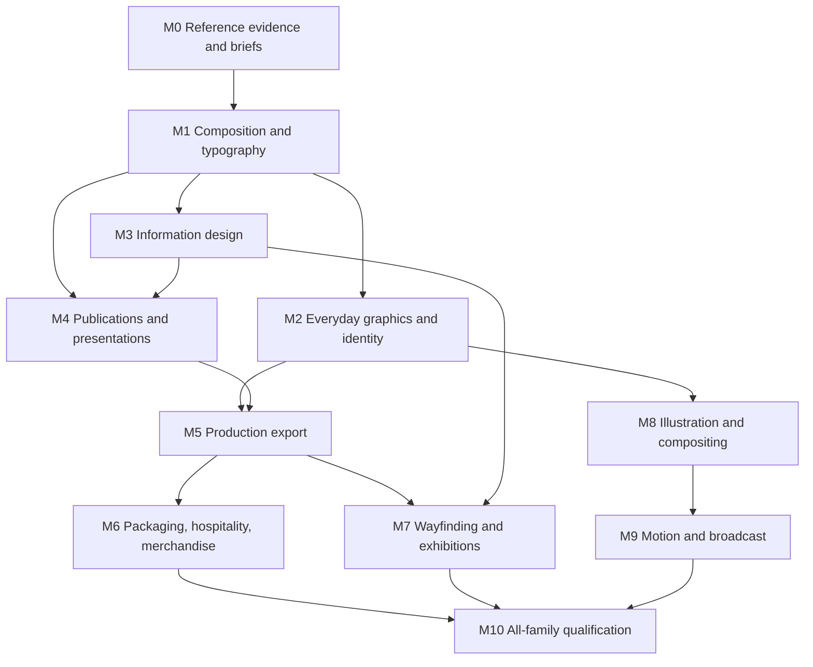

# Graphic design capability roadmap

**Planning baseline: 25 September 2026. Status: proposed execution plan.**

**Static-ad research update:** The [25 September static-ad study](../research/static-ad-design-research-2026-09-25.md)
records 12 inspected Meta ad cards across three advertisers, distinguishes
creative families from export shapes, and recommends six initial creative
families with three core social shapes. Benefit / Feature Proof and
Testimonial / Evidence are the proposed next template slices. The companion
[platform specifications](../research/static-ad-platform-specs-2026-09-25.md)
separates finished artwork from responsive image assets. These are planning
recommendations; no performance optimum or completed family qualification is
claimed.

## Goal and completion rule

Make Glyphkiln useful for the breadth of a graphic designer's daily work:
interpret a brief, develop distinct directions, compose, revise, adapt,
proof, and hand off a reproducible deliverable for its actual medium.

This plan covers 16 work families and 48 benchmark briefs. Landscape, square,
and portrait are output dimensions within a family; they do not count as
three different design disciplines. A successful campaign does not complete
packaging, editorial, identity, or any other family.

Completing this roadmap means every family passes its visual, technical,
production, and authoring gates. It does not mean implementing every feature
of every design application. Native 3D modeling, manufacturing CAD, video
editing, and website engineering are separate integrations where required.
Graphic assets for those uses are included here.

## 1. Honest starting point

| Area                     | Evidence available today                                                                                                                                                                               | Status for this roadmap                                                                            |
| ------------------------ | ------------------------------------------------------------------------------------------------------------------------------------------------------------------------------------------------------ | -------------------------------------------------------------------------------------------------- |
| Research                 | [120 real projects](../../Deliverables/graphic-design-reference-research-2026-09-25/README.md), 11 categories, 18 interpreted style families; 120 source-text reviews, 7 additional visual inspections | Research foundation; 113 visual reviews remain                                                     |
| Campaigns and carousels  | [17 reviewed proofs](../../Deliverables/html/reference-led-review.html), three brands, versioned image/type compositions, SVG/PNG and manifests                                                        | Scoped agent visual review; broad family qualification remains                                     |
| Other semantic templates | Product announcement, statistic card, quote card, article cover                                                                                                                                        | Building blocks; no claim of full discipline coverage                                              |
| Expert geometry          | [Scene Kernel](../scene-kernel.md): bounded primitives, paths, groups, transforms, clips, text, explicit connectors and reading order                                                                  | Existing SDK capability; not a general App editor or automatic layout system                       |
| App                      | Resource admission, brand snapshots, immutable revisions, campaign coordination, exact-revision review and export                                                                                      | Existing workflow foundation; new document families need dedicated authoring flows                 |
| Production               | Deterministic SVG/PNG; resource hashes; proof evidence                                                                                                                                                 | PDF, print separations, publication flow, and motion delivery are not established                  |
| Typography               | Pinned horizontal LTR layout, Thai wrapping, admitted fonts                                                                                                                                            | RTL, broader script coverage, vertical type, and richer typographic controls require explicit work |

This snapshot describes the current working tree, including uncommitted
refinements. The local Core package declares `0.9.1`; that is not a claim
about a published release. Historical release records remain in the
[earlier roadmap](../roadmap.md#historical-execution-status).

## 2. Coverage and benchmark briefs

Each row has a basic, routine professional, and advanced brief: **48 briefs
in total**. Outputs must contain original work, licensed assets, or the
repository's clearly identified fictional assets. Reference artwork is used
for analysis, not supplied as reusable artwork.

Reference IDs resolve to the [source ledger](../../Deliverables/graphic-design-reference-research-2026-09-25/references.json).
“Research gap” requires additional case studies before that family's visual
acceptance; the existing collection is not claimed to cover every subfield.

| ID / work family                        | Basic brief                                  | Routine professional brief                                               | Advanced brief                                                                            | Reference anchors                                              | Main milestones             |
| --------------------------------------- | -------------------------------------------- | ------------------------------------------------------------------------ | ----------------------------------------------------------------------------------------- | -------------------------------------------------------------- | --------------------------- |
| F01 Brand identity                      | Original mark, wordmark, clear-space proof   | Identity kit with horizontal, stacked, monochrome and reversed versions  | Variable identity plus usage guide across five applications                               | IP01 Symphony; IP03 Mailchimp                                  | M1, M2, M4                  |
| F02 Posters and cultural events         | Type-led event poster                        | Festival poster, invitation and ticket family                            | Dense multilingual event programme and large-format poster system                         | EC13 Ruhrtriennale; EC15 Public Design Festival                | M1, M2, M5, M10             |
| F03 Stationery and everyday print       | Business card, front and back                | Letterhead, invoice, envelope and information flyer                      | Variable staff/contact set with long names, QR content and print handoff                  | EI26 Spice Market; add a dedicated stationery case             | M2, M5                      |
| F04 Books and editorial                 | Book cover with front, spine and back intent | 12-page brochure with text, image and caption flow                       | 48-page magazine with contents, sections, running heads and controlled revisions          | EI01 Citizen; EI02 Sight and Sound                             | M4, M5                      |
| F05 Reports and presentations           | Six-slide explanatory deck                   | 20-slide report with master styles and data                              | Annual-report/deck pair with shared data and editable handoff                             | EI17 Artolution; research gap for editable decks               | M3, M4, M5                  |
| F06 Data and infographics               | Correctly scaled chart with source note      | Multi-chart infographic with units, legends and annotations              | Dataset-driven report with missing values, uncertainty and accessible alternatives        | EI16 Nike Viz; EI18 IBM                                        | M3, M4                      |
| F07 Diagrams and maps                   | Labeled process diagram                      | Technical explainer and schematic route map                              | Dense system map with routing, reading order and verified domain claims                   | EI18 IBM is adjacent; add dedicated diagram/map cases          | M1, M3                      |
| F08 Packaging and labels                | Single product label                         | Six-SKU label family with variable information                           | Carton wrap on a supplier dieline, barcode proof and production separation                | IP16 up&up; IP17 Vitaminwater                                  | M5, M6                      |
| F09 Menus and hospitality               | One-page menu with aligned prices            | Menu, room card, table card and service signage                          | Seasonal multi-location system with languages, price changes and long descriptions        | EI26 Spice Market; EC25 Goodtime Hotel                         | M3, M4, M6                  |
| F10 Wayfinding and exhibitions          | Directional sign and pictogram               | Building sign family and visitor directory                               | Exhibition system with panels, routes, viewing-distance proofs and fabrication files      | EC01 Cooper Hewitt; EC03 Princeton                             | M3, M5, M7                  |
| F11 Advertising and social              | Single campaign graphic                      | Poster, banner and carousel adaptation with distinct composition choices | Multi-market campaign with subject protection, copy variation and exact bundle review     | CM01 Nike Run; CM06 Pollen                                     | Existing slice; M1, M2, M10 |
| F12 Web and digital assets              | Thumbnail, cover and hero asset              | Web/email asset family for desktop and mobile placements                 | Product-launch visual system with localization and platform delivery profiles             | CM03 Twitch; CM05 Zigzag                                       | M2, M8, M10                 |
| F13 Illustration, icons and patterns    | Coherent 12-icon family                      | Editorial illustration, spot images and repeating pattern                | Brand illustration system with controlled geometry and seeded variants                    | CM08 Airbnb Tyrus; IP03 Mailchimp                              | M1, M8                      |
| F14 Photo compositing and art direction | Product cutout on a branded field            | Layered photo/type collage with masks and controlled effects             | Multi-image key visual with consistent lighting, rights records and reproducible variants | IP02 Spotify; add dedicated compositing/retouching cases       | M1, M8                      |
| F15 Merchandise and applied graphics    | Tote or T-shirt artwork                      | Placement family for three items and production colors                   | Textile repeat or event merchandise range with supplier handoff                           | EC14 D&AD is adjacent; research gap for merchandise production | M5, M6                      |
| F16 Motion and broadcast                | Five-second type ident                       | Lower thirds, title cards and transition package                         | 15-second identity sequence with timing, multiple aspect ratios and static alternatives   | CM04 Vevo; CM16 Instagram; CM17 NPO                            | M9                          |

Research coverage is explicit: identity → F01; packaging → F08; editorial →
F04/F05; information → F06/F07; print → F03/F09; environment → F10; culture →
F02/F15; hospitality → F09; campaign → F11; digital → F12/F13/F14; motion → F16.

## 3. Shared product foundations

These are reusable capabilities, not a request to add 48 disconnected templates.

| Foundation                             | Planned capability                                                                                                                                  | Architectural boundary                                                                                     |
| -------------------------------------- | --------------------------------------------------------------------------------------------------------------------------------------------------- | ---------------------------------------------------------------------------------------------------------- |
| Composition                            | Grids, columns, baseline rhythm, alignment, reusable components, bounded anchors, subject regions, intentional fit/crop choices                     | Semantic domain compilers produce reviewed geometry; `DesignDocument` stays coordinate-free                |
| Typography                             | Paragraph/character styles, mixed emphasis, optical sizing where supported, explicit OpenType policy, hyphenation, keep rules and copy-fit evidence | Verified fonts and pinned layout policies; no host-font fallback                                           |
| Image and vector craft                 | Aspect-aware image regions, masks, closed blend/effect vocabulary, line/stroke controls, compound paths and scalable marks                          | Audit existing Scene features first; admitted assets remain inert; no arbitrary active SVG/CSS             |
| Structured content                     | Tables, charts, diagrams, data bindings, units, labels, citations and alternative descriptions                                                      | Bounded declarative inputs; no formulas or executable expressions embedded in documents                    |
| Documents and collections              | Master pages, flow, page numbering, contents, linked styles, page/slide/variant identity                                                            | Choose module/package boundaries through a design decision after a working vertical slice                  |
| Production profiles                    | Physical units, trim/bleed/safe zones, image resolution, font handling, validated export profiles                                                   | Keep proof output and verified production output separately identified                                     |
| App workflow                           | Briefs, directions, family-specific controls, asset/style libraries, revisions, proofing and batch handoff                                          | Trusted commands resolve resources and authorization; do not expose raw scenes by bypassing App boundaries |
| Internationalization and accessibility | Language/script coverage, reading order, descriptions, text alternatives and output-specific accessibility checks                                   | Begin in M1; qualify real language pairs and actual export formats                                         |

Preserve deterministic behavior, immutable resources, explicit seeds, bounded
inputs and versioned pixels throughout. Fonts, rasterization, export libraries,
encoding policies and fixtures need pinned identities. Resource ingestion and
remote integrations stay outside render paths.

## 4. Milestone sequence

**All milestones below are planned.** The existing campaign work supplies
evidence and reusable infrastructure; it does not mark any broad milestone done.
Size bands are relative planning estimates: M = a bounded cross-module slice,
L = several coordinated slices, XL = a new output or domain system. Calendar
dates and staffing estimates follow the M0/M1 technical spikes.

| Milestone                                 | Work and tangible delivery                                                                                                                                                                           | Dependencies                                | Size | Exit gate                                                                                                                                                                                                             |
| ----------------------------------------- | ---------------------------------------------------------------------------------------------------------------------------------------------------------------------------------------------------- | ------------------------------------------- | ---- | --------------------------------------------------------------------------------------------------------------------------------------------------------------------------------------------------------------------- |
| M0 Evidence and coverage ledger           | Visually inspect the remaining 113 references; log accessible views, medium, hierarchy, type, crop, materials and limitations; fill research gaps; specify the 48 briefs                             | None                                        | M    | Every family has at least two relevant visually inspected real cases; all 120 existing entries carry explicit visual-review or access-blocked status; blocked entries have replacements before use as visual evidence |
| M1 Composition and type foundation        | Inventory existing primitives; introduce only missing layout/type/image contracts; compare three layout approaches using poster, card and diagram prototypes                                         | M0 briefs for those families                | L    | Short/long copy, complete-subject crops and supplied fonts work across contrasting directions; semantic and Scene boundaries are documented; first language-pair brief selected                                       |
| M2 Everyday graphics and identity         | Ship poster/flyer, stationery, original vector identity applications and digital static assets; expose corresponding App controls                                                                    | M1                                          | L    | F01/F02/F03 basic and routine proofs plus F11/F12 adaptations; each can be created, saved, reopened and revised without editing source code                                                                           |
| M3 Information design                     | Add semantic chart/table/diagram compilers, units, source metadata, annotations and reading order; qualify label placement and explicit routing                                                      | M1                                          | L    | F06/F07 briefs preserve data and domain meaning; long labels, zero/missing values and dense content pass; no invented claims in technical diagrams                                                                    |
| M4 Publications and presentations         | Add multi-page/slide document model, reusable styles, text/image flow, cross-references, page numbering and template-driven decks                                                                    | M1; M3 for tables/charts                    | XL   | F04/F05/F09 document proofs survive copy insertion, page changes and shared-style edits; immutable review pins the entire collection                                                                                  |
| M5 Print and publication export           | Implement physical dimensions, bleed/trim, font embedding/outlining policy, resolution checks, PDF export and output-specific preflight; investigate CMYK, spot colors, overprint and accessible PDF | M1; M2/M4 supply real jobs                  | XL   | Independently inspect exported files; supplier-reviewed print proof and actual accessible-document checks for claimed profiles; unsupported profiles fail clearly                                                     |
| M6 Packaging, hospitality and merchandise | Add supplier-dieline admission, panel roles, SKU/price bindings, barcode/QR handling, production colors, repeats and placement templates                                                             | M2, M3, M4, M5                              | XL   | F08/F09/F15 production briefs pass physical/mock assembly, variable-data checks, scan tests where applicable, and supplier handoff; mockups alone do not pass                                                         |
| M7 Environmental and exhibition systems   | Sign families, pictograms, directories, panel layouts, scale and viewing-distance evidence; external spatial/mockup integration                                                                      | M2, M3, M5                                  | L    | F10 passes real-size/distance review, route/content verification and fabrication constraints; fabrication files and presentation mockups are separately labeled                                                       |
| M8 Digital illustration and compositing   | Expand closed vector craft, masks and reproducible effects; support image admission from external illustration/3D tools; digital delivery profiles and editable asset handoff                        | M1, M2                                      | L    | F12/F13/F14 briefs have coherent assets, clean edges, legible small variants and honest editability; raster mockups are not presented as editable vector artwork                                                      |
| M9 Motion and broadcast                   | Introduce bounded timeline, keyframes, easing, frame rate, duration and deterministic frame rendering; versioned encoder adapter and preview; optional supplied audio tracks                         | M1, M8; M4 collection identity where reused | XL   | F16 passes first/middle/last and sampled-frame review, exact timing, loop boundaries, audio sync where used, platform exports and static/reduced-motion alternatives                                                  |
| M10 Full-family qualification and rollout | Complete multilingual and accessibility gates begun in M1; run all 48 briefs through App and SDK/CLI; validate batch production, revision propagation, exports and recovery                          | M2–M9                                       | L    | Every family satisfies the completion contract below; any unfinished family remains visibly open                                                                                                                      |

### Dependency map

Print and motion each need their own technical spike and acceptance pipeline.
Research can continue while already reviewed briefs enter M1. Internationalization,
accessibility and App integration are acceptance work inside each milestone;
M10 verifies their combined coverage.

## 5. What makes a family complete

Track four separate states per family: **engine**, **authoring**, **visual
quality**, and **production handoff**. Use `planned`, `prototyped`, `implemented`,
`qualified`, or `blocked`, with evidence links and an accountable owner.
Family status cannot exceed its least-complete required state. An SDK-only
demonstration is not an App-complete workflow.

### A. Design review

- Complete all three briefs in the family. Cover at least three contrasting
  art directions and two relevant output specifications across the family suite.
- Across the portfolio, exercise all 18 researched style families. Palette
  swaps do not count as different art directions: vary type, composition,
  imagery and visual language deliberately.
- Attach source links, selected reference observations, original work, exact
  rendered outputs, reviewer notes and revision history. Compare at intended
  viewing size; include physical or time-based review where relevant.
- Use this proposed 100-point rubric: hierarchy 20, typography 20,
  composition 20, brand/style fidelity 15, craft 15, medium fitness 10.
  Target at least 80 overall and at least 60% in every dimension. Scores are
  reviewer judgments with written evidence, not an automated aesthetic metric.
- Any clipped essential subject, incorrect data, unreadable essential copy,
  missing required content or unusable export fails regardless of score.
- Record agent assessment and independent human acceptance separately.
  Human acceptance is required before a family is described as production-qualified.

### B. Stress and content tests

For each family, include short and long copy, long names/numbers, empty optional
content, missing resources, unusual aspect ratios, high/low-resolution images,
extreme crops, light/dark palettes and applicable language pairs. Include a
supported long case and a rejected overflow case. Rejections must explain the
repair needed without silently dropping content.

Use family-specific cases: table row growth; 48-page repagination; barcode
scanability; 100-SKU substitution; 100-output campaign batches; map label
collisions; or a 15-second frame sequence. Preserve bounded jobs and explicit
batch chunks rather than relaxing resource limits.

Record runtime, memory, output size, retries and worst-case rejection time on
a named machine. Establish numerical budgets from the M1/M5/M9 spikes before
qualification; a correct output that exceeds those budgets still fails.

### C. Production and workflow

- Create → compare directions → revise → save → reopen → proof → approve exact
  revision → export → reproduce. Carry linked assets, sources, font licenses,
  output profiles and version identities into the handoff.
- Provide the promised editable source, not just a flattened preview. Choose
  native project JSON, structured SVG, editable slide output or another explicit
  supported interchange format per family. Do not claim lossless Figma, Adobe
  or office round trips without qualification.
- Validate print profiles against the selected printer's requirements and
  current relevant standards during M5; name exact supported profiles after
  testing. Do the equivalent for accessible documents and digital/motion
  delivery. This plan makes no PDF/X, PDF/UA, CMYK or platform-conformance claim.
- Reject unsupported production requirements before labeling an export ready.
  Package final verified outputs by format with matching stable basenames.

### D. Engineering

Every pixel-affecting change needs tests, a deliberate version change and
reviewed baselines. Preserve old exact-version behavior. Run root build,
typecheck, lint, tests and coverage, plus the relevant fixture, package,
schema, determinism and generated-output checks. Numerical data tests and
production preflight complement pixel tests; none substitutes for visual review.

## 6. First execution backlog

Start here; do not open another carousel-only refinement as the next milestone.

| Ticket | Concrete task                                                                              | Completion evidence                                                                                                             | Accountable role                             |
| ------ | ------------------------------------------------------------------------------------------ | ------------------------------------------------------------------------------------------------------------------------------- | -------------------------------------------- |
| GD-001 | Turn the 16-family matrix into a capability ledger with four states per family             | Every row has current evidence, missing capability and next ticket; no family inherited a campaign's completion                 | Product/design lead                          |
| GD-002 | Visually inspect reference pairs for posters, identity, stationery, diagrams and editorial | Ten or more specific visual observations, source URLs and applicable original briefs; source gaps named                         | Graphic designer/researcher                  |
| GD-003 | Inventory Scene primitives, typography and App control gaps against those five briefs      | Reuse/missing-feature matrix and one bounded architecture decision                                                              | Core + App engineers                         |
| GD-004 | Produce three original art directions for an event poster                                  | Type-led, image-led and illustrative concepts compared at actual delivery size                                                  | Graphic designer + Core engineer             |
| GD-005 | Implement poster/flyer authoring and proof export                                          | Saved/reopened poster and two-sided flyer; short/long copy; explicit print-preview limitation until M5                          | Core + App engineers                         |
| GD-006 | Produce identity and stationery applications                                               | Original vector mark kit, business card and letterhead with exact supplied fonts and editable sources                           | Graphic designer + Core engineer             |
| GD-007 | Produce a source-grounded infographic and process diagram                                  | Verified values, units, labels, semantic endpoints, reading order and no invented technical claims                              | Information designer + Core engineer         |
| GD-008 | Prove a 12-page brochure and 6-slide presentation                                          | Document model decision, text-flow proof, shared style revision and clearly labeled export capabilities                         | Editorial designer + engineers               |
| GD-009 | Spike production PDF on the flyer, brochure and label                                      | Written profile decision, independent file inspection, reproduction policy and supplier requirements                            | Core/export engineer + production specialist |
| GD-010 | Review the first cross-discipline portfolio                                                | At least poster, stationery, identity, infographic, diagram, brochure and deck evidence; rejected work has a next revision task | Design lead + independent reviewer           |

Roles describe needed responsibility, not assigned people or confirmed staffing.
If one person owns several roles, record each review separately. After GD-003,
estimate the first implementation slice; after GD-009, estimate print and
packaging. Motion receives its own estimate after its timeline/encoder spike.

## 7. Progress and scope control

At each milestone review, publish:

1. Families attempted and briefs completed, including failures.
2. Engine, App, visual and production state for every affected family.
3. Before/after proofs and reference-based critique.
4. Test, performance, export and reproduction evidence.
5. Remaining blockers, next tickets, and revised estimates.

Do not report “all graphic design covered” until all 16 families qualify. Keep
research completion, prototype completion, release readiness and designer
acceptance separate. Additional scope found during real briefs becomes an
explicit ticket instead of being silently omitted or claimed complete.

## Related evidence and plans

- [Reference research and methodology](../../Deliverables/graphic-design-reference-research-2026-09-25/README.md)
- [Original designer stress test](../../Deliverables/designer-stress-test-2026-09-25/)
- [Campaign/carousel refinement and limitations](../reference-led-refinement.md)
- [Known limitations](../known-limitations.md)
- [Scene Kernel architecture](../scene-kernel.md)
- [Existing App execution plan](post-alpha-next-milestones.md)
- [Version ownership and compatibility](../versioning.md)

The roadmap is a planning deliverable. Its creation does not implement or
qualify the proposed capabilities, schedule background work, or authorize a
production release.

## Implemented slice: product-and-offer static ads

`product-announcement@1.2.0` implements a bounded F11/F12 composition with
contained product imagery, offer, CTA, terms, and manual App controls.
See [implementation and proof evidence](../product-offer-template.md).
Engine and authoring are implemented for this slice; agent visual review and
reproducible digital proofs do not complete M2 or qualify the full family.
Independent human acceptance and wider family briefs remain open.

## Implemented slice: benefit / feature proof

`benefit-proof@1.0.0` adds a benefit headline, one to three structured facts,
optional contained product/logo, action and source across four canvas presets.
DesignDocument 1.5.0 and authoring metadata 1.6.0 publish the bounded collection;
manual App controls and immutable revision handling support it end to end.
See [implementation and six reviewed proofs](../benefit-proof-template.md).
This completes the next template slice from the static-ad research; it does not
qualify the entire family. The remaining starter families are implemented below.

## Implemented slice: complete static-ad starter set

`testimonial-evidence@1.0.0`, `comparison@1.0.0`, `problem-solution@1.0.0` and
`offer-urgency@1.0.0` complete the six-family starter set alongside the two slices
above. Each supports four existing canvas presets and manual App editing with
immutable revisions. DesignDocument 1.6.0 and authoring metadata 1.7.0 add bounded
comparison and problem/solution content. See the [contracts and 24-proof gallery](../static-ad-starter-set.md).
This is implementation and agent visual-review evidence, not full F11/F12 or
platform qualification. Next milestones are independent design acceptance,
placement-safe delivery profiles and campaign testing using real supplied briefs.

## Implemented slice: static-ad campaign workflow

The six-family starter set now has a shared-brief App workflow, atomic saving of
up to 24 family/format variants, a batch proof and approval board, and approved-only
ZIP delivery with placement review reports. See [workflow and limits](../static-ad-campaign-workflow.md).
Placement policy 1.0.0 provides explicit advisory overlays and small-screen text
checks; it does not qualify platform acceptance, change template pixels or prove
campaign effectiveness. Independent design review and real campaign measurement
remain open.
