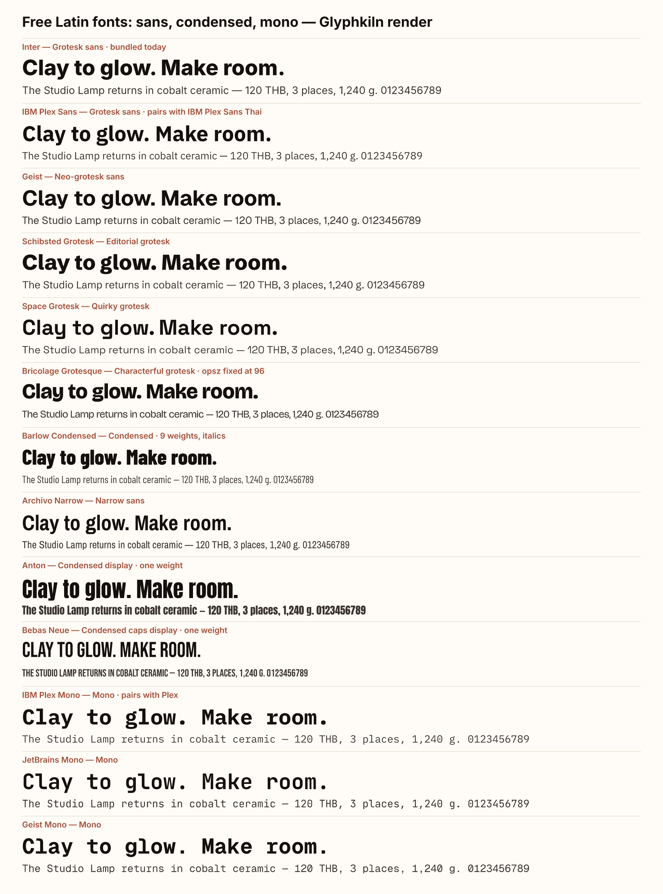
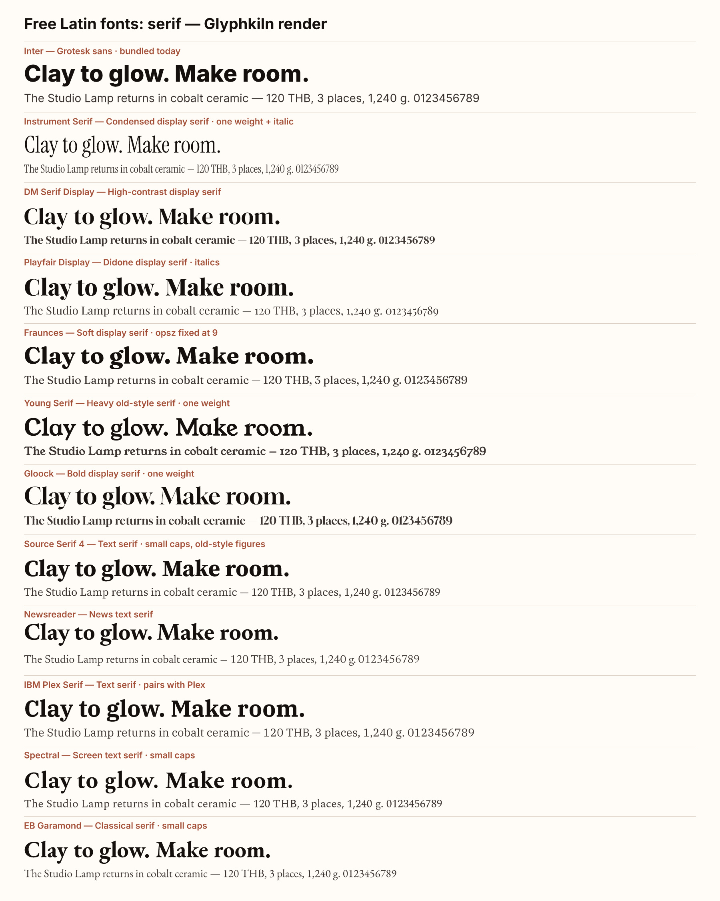

# Free Latin fonts for Glyphkiln

**Researched 4 November 2026 by Claude (Opus 5.5) for owner decision D3 in the
[open-work plan](../../plans/open-work-plan.md). Status: the six-family
[Latin starter set](#recommended-latin-starter-set) was approved by the owner on
4 November 2026. The fonts are not bundled yet.**

This complements the approved [Thai + Latin set](../thai-latin-fonts-2026-11/README.md)
(IBM Plex Sans Thai, Noto Sans Thai, Sarabun, Kanit, Trirong, Noto Serif
Thai). Those six already contain Latin, so any mixed Thai/English text uses
them. The fonts here are for **English-only** text that needs a voice, figure
style or feature the Thai set lacks: monospace, condensed display, expressive
display serifs, and text serifs with small caps and old-style figures.

| Sans, condensed and mono            | Serif                                 |
| ----------------------------------- | ------------------------------------- |
|  |  |

Both sheets were rendered by Glyphkiln Core's Scene Kernel
([`specimen.mjs`](specimen.mjs)) with the exact files below. Core reported no
quality issues. Two sheets are needed because a scene accepts at most 32 font
faces.

## Method

- Source: [google/fonts](https://github.com/google/fonts) `ofl/`, read from
  each family's `METADATA.pb` and font files on 4 November 2026 (repository
  head `2fe1e8c` as of 2 November). Every family below is **OFL 1.1**.
- 55 families were checked with Core's `fontkit 2.0.4`: A–Z, a–z, 0–9, common
  punctuation, € £, and Western European accents (à é î õ ü ç ñ ß ø å œ).
  **All 55 have complete coverage.**
- OpenType features (`tnum`, `onum`, `smcp`, `case`, `frac`, `zero`, stylistic
  sets), digit widths and variable-axis defaults were read from the same
  files.

## One engine limit that changes the choice

Glyphkiln's `FontRegistry` sets **only the weight axis** of a variable font.
Every other axis stays at the font's default. That matters for fonts with an
optical-size (`opsz`) axis:

| Font                | Default `opsz`     | Effect today                                                               |
| ------------------- | ------------------ | -------------------------------------------------------------------------- |
| Fraunces            | 9 (small text cut) | Headlines use the heavy, low-contrast text design; the specimen shows it   |
| Bricolage Grotesque | 96 (display cut)   | Body text uses tight display spacing; visible in the specimen's small line |
| Source Serif 4      | 20                 | Fine for text; headlines miss the sharper display cut                      |
| Inter (bundled)     | 14                 | Fine for text; large headlines miss the display cut                        |

So fonts that depend on `opsz` or width (`wdth`) are listed as **later**
choices, after a small, versioned Core change that lets a document pick those
axes.

## Shortlist by role

| Role                  | Family                  | Styles                                         | Figures and features                              | Notes                                                                               |
| --------------------- | ----------------------- | ---------------------------------------------- | ------------------------------------------------- | ----------------------------------------------------------------------------------- |
| **Grotesk sans**      | **IBM Plex Sans**       | Variable weight 100–700, width 75–100, italics | Tabular digits by default; `onum`, `zero`, `ss01` | Same design family as the approved IBM Plex Sans Thai. Width needs the Core change. |
|                       | Inter                   | Bundled now                                    | `tnum`, `case`, `zero`                            | Keep as the default.                                                                |
|                       | Geist                   | Weight 100–900, italics                        | `tnum`, `case`                                    | Neutral neo-grotesk.                                                                |
| **Editorial grotesk** | **Schibsted Grotesk**   | Weight 400–900, italics                        | `tnum`, `case`, `zero`                            | Distinct headline voice from Inter and Plex.                                        |
|                       | Space Grotesk           | Weight 300–700, no italic                      | `tnum`, `onum`, `case`                            | Quirky, tech feel.                                                                  |
|                       | Bricolage Grotesque     | Weight 200–800, width, opsz                    | `tnum`, `onum`                                    | Later, after axis support.                                                          |
| **Condensed**         | **Barlow Condensed**    | 9 static weights, italics                      | `tnum`, `smcp`                                    | Works now for posters, prices, labels.                                              |
|                       | IBM Plex Sans Condensed | 7 static weights, italics                      | Tabular digits                                    | Condensed Plex that works now, without the width axis.                              |
|                       | Archivo Narrow          | Weight 400–700, italics                        | `tnum`, `onum`, `case`                            |                                                                                     |
|                       | Anton                   | One weight                                     | `smcp`, `case`                                    | Very heavy condensed display.                                                       |
|                       | Bebas Neue              | One weight, caps only                          | `tnum`                                            | All-caps headlines only.                                                            |
| **Display serif**     | **Instrument Serif**    | One weight, italic                             | `case`                                            | Elegant condensed serif; works now.                                                 |
|                       | DM Serif Display        | One weight, italic                             | `frac`                                            | High contrast.                                                                      |
|                       | Playfair Display        | Weight 400–900, italics                        | `smcp`, `onum` (old-style by default)             | Didone.                                                                             |
|                       | Young Serif, Gloock     | One weight each                                | `tnum`, `zero`                                    | Heavy, characterful headlines.                                                      |
|                       | Fraunces                | Weight 100–900, opsz, SOFT, WONK, italics      | `case`                                            | Later, after axis support.                                                          |
| **Text serif**        | **Source Serif 4**      | Weight 200–900, opsz, italics                  | Tabular digits; `smcp`, `onum`, `lnum`, `case`    | Best feature set for editorial text.                                                |
|                       | Newsreader              | Weight 200–800, opsz, italics                  | Tabular digits                                    | Tall line metrics leave extra space under headlines in the specimen.                |
|                       | IBM Plex Serif          | 7 static weights, italics                      | Tabular digits                                    | Pairs with Plex.                                                                    |
|                       | Spectral, EB Garamond   | Static / weight 400–800, italics               | `smcp`, `onum`                                    | Literary and classical.                                                             |
| **Monospace**         | **IBM Plex Mono**       | 7 static weights, italics                      | Tabular; `zero`                                   | Fills the gap the Thai set left. Pairs with Plex.                                   |
|                       | JetBrains Mono          | Weight 100–800, italics                        | `zero`                                            |                                                                                     |
|                       | Geist Mono              | Weight 100–900, italics                        |                                                   |                                                                                     |

Also checked with full coverage but not shortlisted: Archivo, Big Shoulders
Display, Cormorant Garamond, Crimson Pro, DM Sans, Familjen Grotesk, Figtree,
Hanken Grotesk, Instrument Sans, Libre Caslon Text, Libre Franklin, Literata,
Lora, Manrope, Noto Sans, Noto Serif, Oswald, Outfit, Playfair (variable), Plus
Jakarta Sans, PT Serif, Public Sans, Red Hat Display and Text, Sora, Source
Sans 3, Space Mono, Syne, Unbounded, Work Sans.

## Recommended Latin starter set

Six families, about 7.4 MB, all usable with Core today:

| Role                                             | Family            | Files                      | Size   |
| ------------------------------------------------ | ----------------- | -------------------------- | ------ |
| Grotesk sans (pairs with Plex Sans Thai)         | IBM Plex Sans     | 2 variable (roman, italic) | 1.1 MB |
| Editorial grotesk headlines                      | Schibsted Grotesk | 2 variable                 | 349 KB |
| Condensed display                                | Barlow Condensed  | 18 static                  | 1.9 MB |
| Display serif                                    | Instrument Serif  | 2 static                   | 138 KB |
| Text serif with small caps and old-style figures | Source Serif 4    | 2 variable                 | 2.0 MB |
| Monospace                                        | IBM Plex Mono     | 14 static                  | 1.9 MB |

Together with the six approved Thai + Latin families, this covers every type
role in the design-quality plan (W3): grotesk, condensed, display serif, text
serif and mono in English, and sans, display and serif in Thai.

**After Core can set `opsz` and `wdth`:** add Fraunces and Bricolage
Grotesque, and use IBM Plex Sans's width axis and Noto Sans Thai's condensed
widths.

## Decision

Approved by the owner on 4 November 2026: IBM Plex Sans, Schibsted Grotesk,
Barlow Condensed, Instrument Serif, Source Serif 4 and IBM Plex Mono.

## Files checked (SHA-256)

| File                                     | SHA-256                                                            |
| ---------------------------------------- | ------------------------------------------------------------------ |
| `IBMPlexSans[wdth,wght].ttf`             | `3b031aa4216174205bd8471f88a49b91f093169e9e87bd5262242bc5967fe2e3` |
| `IBMPlexSans-Italic[wdth,wght].ttf`      | `0b94c5e981993764db32bf9c610ecc60cbd34ad77ec2f10ba03c64ab75124d8e` |
| `SchibstedGrotesk[wght].ttf`             | `6ceeadf6be8e1fd7687011c7fa38ed0edd1abe967a0b73d97caec183552e823d` |
| `SchibstedGrotesk-Italic[wght].ttf`      | `b49fedb6f3a2ff9b43e13351888641505dc8e5f300941e597eecbc3f52ba357b` |
| `BarlowCondensed-Regular.ttf`            | `583cec5da3b84bc4dc7c9c72e2a565c94d34e431518b19d7e250b7830ad5f996` |
| `InstrumentSerif-Regular.ttf`            | `498efd461f6ddfcb7a111bf9a565709d2085d48201d501ead960d93e84ffbb88` |
| `InstrumentSerif-Italic.ttf`             | `08939b8bdf534afec24ae0ef5e03f948940cd9a8fe08e7fecbad040e62327385` |
| `SourceSerif4[opsz,wght].ttf`            | `97b2d4da6e3cb494b5a1e66ae176914d852ccabef49e0c02c0df25f3e39aca0b` |
| `SourceSerif4-Italic[opsz,wght].ttf`     | `15fbc7e4679489a501998c3669272637a6646388ef7e4bd77eebb5bf967a1f42` |
| `IBMPlexMono-Regular.ttf`                | `6a3412f058c7d8dfd9170c41e85ade48e5156ecb89356110ca57a0a27734af46` |
| `Fraunces[SOFT,WONK,opsz,wght].ttf`      | `177ff6c0f14e5550a3c624247cd1189611d4eb65d000b14944c63d967958abbb` |
| `BricolageGrotesque[opsz,wdth,wght].ttf` | `413e7357809ddd12fd80a96a8a396de0e401638d4acd3cb3e37532f0472ac682` |
| `DMSerifDisplay-Regular.ttf`             | `8cc3643535edf039aa5d95440a8542735e9197e4f4b8d9303e980fefbf5ab616` |
| `Anton-Regular.ttf`                      | `a4ba3a92350ebb031da0cb47630ac49eb265082ca1bc0450442f4a83ab947cab` |
| `JetBrainsMono[wght].ttf`                | `48715a42ec242c21e9f02692891e147d022299a52e48d5e413e1a942193ffeda` |

Other static weights were checked from the same source; record their hashes
when they are admitted.
