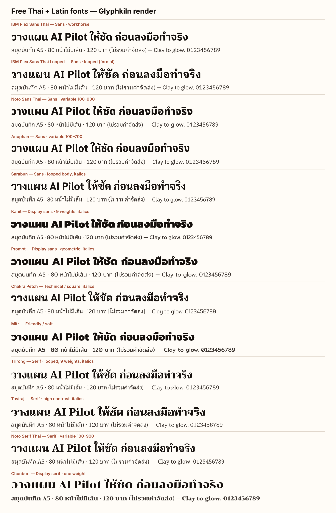

# Free Thai + Latin fonts for Glyphkiln

**Researched 4 November 2026 by Claude (Opus 5.5) for owner decision D3 in the
[open-work plan](../../plans/open-work-plan.md). Status: the six-family
[starter bundle](#recommended-starter-bundle) was approved by the owner on
4 November 2026 and bundled in Core on 4 November 2026 (`packages/glyphkiln-core/assets/fonts/`, see [Font loading](../../fonts.md)).**

The specimen above was rendered by Glyphkiln Core's Scene Kernel
([`specimen.mjs`](specimen.mjs)) with the exact files listed below: one Thai
display line and one mixed Thai/Latin line with numbers per family. Core
reported no quality issues, and Thai tone marks and vowels stack correctly
(for example ให้, ก่อน, ไม่). This is a typeface comparison, not a design
review of any graphic.

## Why the font has to contain both scripts

Glyphkiln has **no font fallback stacks**: each text element is shaped with one
exact face ([known limitations](../../known-limitations.md)). Mixed Thai and
English copy such as "วางแผน AI Pilot" therefore needs one family that covers
both scripts. A Latin-only font can only be used for Latin-only text.

## Method

- Source: [google/fonts](https://github.com/google/fonts) `ofl/` directory at
  commit `2fe1e8c6b137fb13041a7cfca6fdcd8a910ea4dc` (2 November 2026), read
  from each family's `METADATA.pb` and font files.
- License: every family below is listed as **OFL** (SIL Open Font License 1.1)
  in its metadata. OFL allows commercial use, embedding, modification, and
  redistribution with the license file; only selling the font files on their
  own is not allowed.
- Coverage: each file was opened with the same `fontkit 2.0.4` Core uses, and
  checked for every Thai character U+0E01–U+0E5B (except unassigned
  code points) and for A–Z, a–z, 0–9 and common punctuation including “ ” ‘ ’ …
  – — € £. **All 25 Thai families checked have complete Thai and Latin
  coverage.**
- OpenType features and digit widths were read from the same files.

## Shortlist

| Family                    | Role it can play                                | Weights / italics                                     | Thai style | Latin digits | Notes                                                                                        |
| ------------------------- | ----------------------------------------------- | ----------------------------------------------------- | ---------- | ------------ | -------------------------------------------------------------------------------------------- |
| **IBM Plex Sans Thai**    | Workhorse sans: body, labels, UI, headlines     | 100–700 static, no italic                             | Loopless   | Tabular      | Named in GD20 benchmark briefs A, C, D. Pairs with the Latin-only IBM Plex family.           |
| IBM Plex Sans Thai Looped | Formal or long-form body                        | 100–700, no italic                                    | Looped     | Tabular      | Same Latin as Plex Sans Thai.                                                                |
| **Noto Sans Thai**        | Workhorse sans; future condensed via width axis | Variable weight 100–900 and width 62.5–100, no italic | Loopless   | Tabular      | Already in the repository's Thai Scene fixture (same SHA-256). Named in benchmark brief B.   |
| Noto Sans Thai Looped     | Formal body                                     | Variable 100–900, width 62.5–100                      | Looped     | Tabular      |                                                                                              |
| Anuphan                   | Modern sans, large x-height                     | Variable 100–700, no italic                           | Loopless   | Tabular      | Has a `case` feature.                                                                        |
| **Sarabun**               | Readable body text with true italics            | 100–800, italics for every weight                     | Looped     | Tabular      | By Suppakit Chalermlarp, designer of TH Sarabun PSK, which is widely used in Thai documents. |
| **Kanit**                 | Display headlines, posters, ads                 | 100–900, italics                                      | Loopless   | Proportional | Very strong heavy weights.                                                                   |
| Prompt                    | Geometric display                               | 100–900, italics                                      | Loopless   | Proportional |                                                                                              |
| Chakra Petch              | Technical, square, tech brands                  | 300–700, italics                                      | Loopless   | Proportional |                                                                                              |
| Mitr                      | Friendly, soft                                  | 200–700, no italic                                    | Loopless   | Proportional | Zero has a slash (visible in "80", "120").                                                   |
| **Trirong**               | Serif for quotes and editorial                  | 100–900, italics                                      | Looped     | Tabular      |                                                                                              |
| Taviraj                   | High-contrast serif                             | 100–900, italics                                      | Looped     | Tabular      |                                                                                              |
| Noto Serif Thai           | Serif, variable                                 | Variable 100–900, width 62.5–100                      | Looped     | Tabular      |                                                                                              |
| Chonburi                  | Display serif                                   | One weight                                            | Looped     | Proportional | Display only.                                                                                |

Also verified with full coverage but not shortlisted: Athiti, Bai Jamjuree,
K2D, Krub, Maitree, Niramit, Pridi (text sans/serif alternatives), and Charm,
Itim, Pattaya, Sriracha (handwriting and novelty display).

## Recommended starter bundle

Six families, about 9.5 MB of font files, covering every type role in the
design-quality plan (W3) except monospace:

| Role                            | Family             | Files      | Size   |
| ------------------------------- | ------------------ | ---------- | ------ |
| Workhorse sans                  | IBM Plex Sans Thai | 7 static   | 805 KB |
| Variable sans, future condensed | Noto Sans Thai     | 1 variable | 214 KB |
| Body with italics               | Sarabun            | 16 static  | 1.4 MB |
| Display headline                | Kanit              | 18 static  | 3.1 MB |
| Editorial serif                 | Trirong            | 18 static  | 3.7 MB |
| Variable serif                  | Noto Serif Thai    | 1 variable | 285 KB |

Each family is admitted as an immutable font resource with its OFL text and
SHA-256, as Core already requires for supplied fonts. Inter stays the bundled
development default.

## What this means for the engine

- **Width axis is not used yet.** `FontRegistry` currently varies only the
  weight axis, so Noto's condensed widths need a small, versioned Core change
  before they can serve the condensed-display role.
- **No Thai family has tabular-figure, old-style-figure or small-caps
  features** (`tnum`, `onum`, `smcp`). B2's OpenType controls will report
  `OPENTYPE_FEATURE_UNAVAILABLE` for them. Latin digits are already
  fixed-width in IBM Plex Sans Thai, Noto, Anuphan, Sarabun, Trirong and
  Taviraj, which helps price and number layouts. Thai digits are proportional
  in every family.
- **Italic emphasis** (B2's `italic` style) works only with families that ship
  italic files: Sarabun, Kanit, Prompt, Chakra Petch, Trirong, Taviraj. It is
  unavailable in IBM Plex Sans Thai, Noto and Anuphan; Core never synthesizes
  italics.
- **Optical sizing between scripts:** x-height ratios range from 0.47 (Kanit,
  Taviraj) to 0.57 (Anuphan), so Thai and Latin set at the same point size will
  not look equal across families. Pairing rules should be per family.

## Gaps

- **Monospace:** no OFL font covering both Thai and Latin was found. The
  [TLWG fonts](https://github.com/tlwg/fonts-tlwg/blob/master/COPYING)
  TlwgMono and TlwgTypo cover Thai but are GPL-2 with a font-embedding
  exception, a different license from the rest of this set; treat them as
  optional caller-supplied fonts, not bundled files. For Latin-only codes and
  prices, Noto Sans Mono (OFL, variable) has `onum` and `smcp`.
- **LINE Seed Sans TH** is a modern Thai + Latin sans that its publisher states
  is released under OFL 1.1 ([official site](https://seed.line.me/)). It is not
  on Google Fonts and was **not downloaded or tested here**.

## Decision

Approved by the owner on 4 November 2026: IBM Plex Sans Thai, Noto Sans Thai,
Sarabun, Kanit, Trirong and Noto Serif Thai. Latin-only companion fonts are
researched separately.

## Files checked (SHA-256)

| File                                | SHA-256                                                            |
| ----------------------------------- | ------------------------------------------------------------------ |
| `IBMPlexSansThai-Regular.ttf`       | `eee061d1bac39be40f9bb94498898cd1894f5d3d9a2f0ee6cbd48a6bd03d052b` |
| `IBMPlexSansThai-Bold.ttf`          | `f88fbe0a3717c93deddf4b13e50a05c9adcd38f58d675d9d5d0b869961851667` |
| `IBMPlexSansThaiLooped-Regular.ttf` | `6d7910d13a7a9e33872d5501fd81a71f84ee532f729bfb72c6ffa94d1f13009e` |
| `NotoSansThai[wdth,wght].ttf`       | `5a1c559bb539583c8a1fd99d1c5b9491e5e14478c9cd2bd0970d5c3096cc9ef8` |
| `Anuphan[wght].ttf`                 | `7ec47ebcaa9d6459d974691cbb42fae52e1449478a607b071bfaf3ccdb433ce4` |
| `Sarabun-Regular.ttf`               | `226d4f368fbc0457990ddef2692679badfd2c1a4e89e5ac4d43c10ba7743b2f1` |
| `Kanit-Regular.ttf`                 | `27170c049660b2f962d3ed28441fd20f4c743503ca031fec9c2b4542d6c52736` |
| `Prompt-Regular.ttf`                | `dbd497803cec3caffbc6b7f599ca6fed8beea0ed7e0ad1e098130c5ebbc4fd42` |
| `ChakraPetch-Regular.ttf`           | `98fcd638baa5c81ff0316b7538ce330ee3b23b1302726de3526d5933a8ecf986` |
| `Mitr-Regular.ttf`                  | `3763923ca8d860f9c06f483f663cd3d8d94e9ed8c2f35a7ce35bb6b13e1219fd` |
| `Trirong-Regular.ttf`               | `3cd19b35a24df5fcf12c1f917324cf821d5aa582f7ea36fb0d2a91ba5e8ccd05` |
| `Taviraj-Regular.ttf`               | `077e6299711fddca973f9d43455949018459c2d29c6e790666d41017ee1a27d5` |
| `NotoSerifThai[wdth,wght].ttf`      | `34a7ad11647c845303aabdde639059806c56b84719e5d2ceb28eb038711bdf53` |
| `Chonburi-Regular.ttf`              | `aa0dac4df08af10785ba1dc10121492227f8e4288f0a23d11dd1d1f5a7f6ebfa` |

Every admitted file, with its hash, is recorded in
`packages/glyphkiln-core/assets/fonts/catalog.json`.
