# Typography M1 baseline review sheet

**Generated by `packages/glyphkiln-core/scripts/typography-m1-review-sheet.mjs`
from the exact PNG baselines in `packages/glyphkiln-core/tests/visual/m1/`.
Status: candidates awaiting the owner's review. They have not been reviewed.**

Every image is a renderer 0.6.0 baseline on the M1 typography:
harfbuzzjs 1.6.4 / HarfBuzz 15.0.0, `script-runs@1.0.0`,
`cluster-tracking@1.0.0`, `font-variation@1.0.0`,
`optical-size-auto@1.0.0` (provisional Q6 mapping, opsz = 0.75 × px at the
1080 px reference) and `script-matching@1.0.0`. The previews are the same
pixels downsampled to 360 px wide, the phone-feed width of the
benchmark delivery views.

What to check, per the plan (§5 M1 exit gate, §6):

- Thai marks sit on their bases, with no collisions or dropped marks (ให้,
  ก่อน, น้ำ, ปู่, ญี่ปุ่น), including on the tracked 36 px lines. Open the
  master for this: marks are a fraction of the x-height, so the 360 px
  preview judges reading, not mark placement.
- Latin and Thai look the same size in each pairing (`script-matching` auto
  scale), and the shared baseline holds.
- Display sizes use the display cut where the face has `opsz` (Inter,
  Source Serif 4).
- Text reads at the delivery view. Every case is craft-reviewed at its
  delivery width (`craft-review` policy, minimum x-height 5.5 px). The test
  pins the result beside each baseline (`<name>.craft.json`) and fails the
  specimens, brief A and the Kilnform quote on any finding not listed as
  accepted. Brief A is checked at both the 360 px phone width and its own
  400 px delivery view. A person still judges legibility; the review only
  rules out text that is too small.
- Accepted findings, left visible for review:
  - specimens are type sheets, not compositions, so their empty canvas bands
    (`CRAFT_DEAD_SPACE`) are expected;
  - `quote-card@1.4.0` sets the attribution at 34 px, and Source Serif 4's
    small x-height lands at 5.38 px at 360 px in `kilnform-quote-noto-serif`,
    just under the threshold. Changing it is a template decision.
- `image-led-campaign-m1-square` keeps B2's copy sizes, so it inherits B2's
  small eyebrow, subtitle and CTA and the low-visibility Kilnform mark
  (decision D7). These are reported, not asserted.
- The Thai–Latin pairings are provisional choices for the owner to accept or
  change.
- The Kilnform quote copy is Latin only, so each pairing's Thai fallback is
  declared in its stack but draws nothing; the quote checks the Latin face,
  optical size and tracking. Brief A exercises the Thai and Latin faces.
- `quote-card-m1`, `statistic-card-m1` and `image-led-campaign-m1-square`
  are the existing B2 baselines (Inter) on the new template versions; they
  show what the version switch changes (optical size, cluster tracking).

## Family specimens: 112, 56 and 36 px (36 px tracked +1.8 px, 0.05 em) on Scene 1.1.0, 1080 × 1080

| Baseline                                                        | Faces drawn (manifest font identity v2)                                                                                                                                    | Craft review at delivery width                               | 360 px phone preview                                                               | Master                                                                                        |
| --------------------------------------------------------------- | -------------------------------------------------------------------------------------------------------------------------------------------------------------------------- | ------------------------------------------------------------ | ---------------------------------------------------------------------------------- | --------------------------------------------------------------------------------------------- |
| `specimen-barlow-condensed` 1080 × 1080 `93716f7401b6…`   | Barlow Condensed 400 (primary; Latin)                                                                                                                                      | 360 px: smallest x-height 6.07 px; `CRAFT_DEAD_SPACE:canvas` | 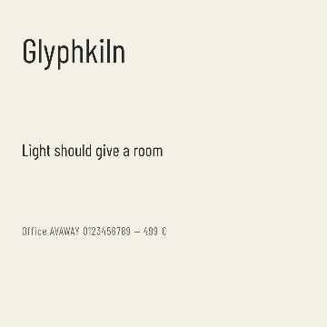     | [full size](../../../packages/glyphkiln-core/tests/visual/m1/specimen-barlow-condensed.png)   |
| `specimen-ibm-plex-mono` 1080 × 1080 `8cf1b649e003…`      | IBM Plex Mono 400 (primary; Latin)                                                                                                                                         | 360 px: smallest x-height 6.19 px; no findings               | 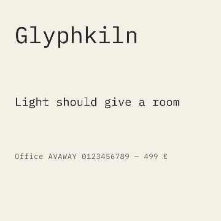           | [full size](../../../packages/glyphkiln-core/tests/visual/m1/specimen-ibm-plex-mono.png)      |
| `specimen-ibm-plex-sans` 1080 × 1080 `18d0abbd3b80…`      | IBM Plex Sans 400 (primary; wdth 100, wght 400; Latin)                                                                                                                     | 360 px: smallest x-height 6.19 px; `CRAFT_DEAD_SPACE:canvas` | 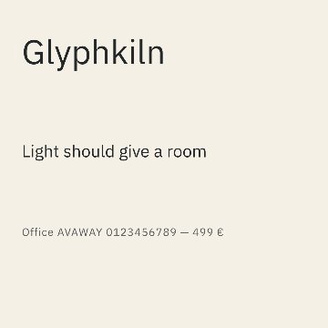           | [full size](../../../packages/glyphkiln-core/tests/visual/m1/specimen-ibm-plex-sans.png)      |
| `specimen-ibm-plex-sans-thai` 1080 × 1080 `50a4b813a13a…` | IBM Plex Sans Thai 400 (primary; Latin+Thai)                                                                                                                               | 360 px: smallest x-height 6.19 px; `CRAFT_DEAD_SPACE:canvas` | 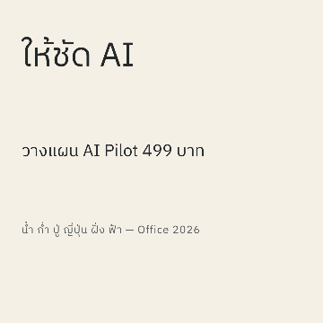 | [full size](../../../packages/glyphkiln-core/tests/visual/m1/specimen-ibm-plex-sans-thai.png) |
| `specimen-instrument-serif` 1080 × 1080 `b20b8e1b9ed4…`   | Instrument Serif 400 (primary; Latin)                                                                                                                                      | 360 px: smallest x-height 6.12 px; `CRAFT_DEAD_SPACE:canvas` | 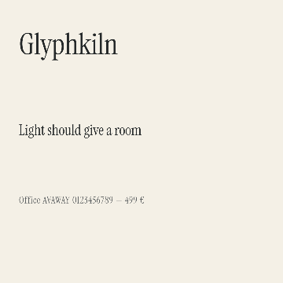     | [full size](../../../packages/glyphkiln-core/tests/visual/m1/specimen-instrument-serif.png)   |
| `specimen-kanit` 1080 × 1080 `622bf4de9063…`              | Kanit 400 (primary; Latin+Thai)                                                                                                                                            | 360 px: smallest x-height 5.69 px; `CRAFT_DEAD_SPACE:canvas` | 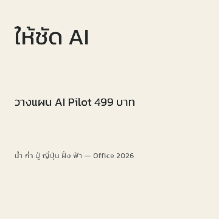                           | [full size](../../../packages/glyphkiln-core/tests/visual/m1/specimen-kanit.png)              |
| `specimen-noto-sans-thai` 1080 × 1080 `8e0dbb317a67…`     | Noto Sans Thai 400 (primary; wdth 100, wght 400; Latin+Thai)                                                                                                               | 360 px: smallest x-height 6.67 px; `CRAFT_DEAD_SPACE:canvas` | 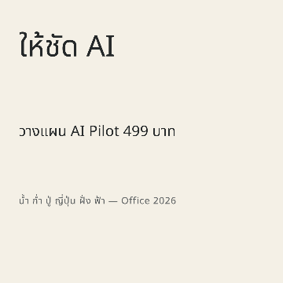         | [full size](../../../packages/glyphkiln-core/tests/visual/m1/specimen-noto-sans-thai.png)     |
| `specimen-noto-serif-thai` 1080 × 1080 `d8a342fb3f80…`    | Noto Serif Thai 400 (primary; wdth 100, wght 400; Latin+Thai)                                                                                                              | 360 px: smallest x-height 6.43 px; `CRAFT_DEAD_SPACE:canvas` | 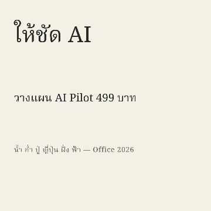       | [full size](../../../packages/glyphkiln-core/tests/visual/m1/specimen-noto-serif-thai.png)    |
| `specimen-sarabun` 1080 × 1080 `78c333215f4f…`            | Sarabun 400 (primary; Latin+Thai)                                                                                                                                          | 360 px: smallest x-height 6.00 px; `CRAFT_DEAD_SPACE:canvas` | 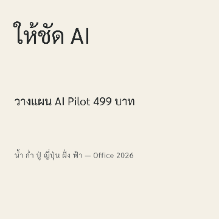                       | [full size](../../../packages/glyphkiln-core/tests/visual/m1/specimen-sarabun.png)            |
| `specimen-schibsted-grotesk` 1080 × 1080 `4c27fcdda41d…`  | Schibsted Grotesk 400 (primary; wght 400; Latin)                                                                                                                           | 360 px: smallest x-height 6.33 px; `CRAFT_DEAD_SPACE:canvas` | 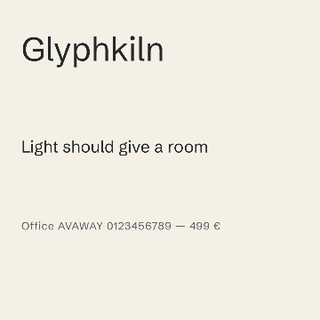   | [full size](../../../packages/glyphkiln-core/tests/visual/m1/specimen-schibsted-grotesk.png)  |
| `specimen-source-serif-4` 1080 × 1080 `1e9324a22cf6…`     | Source Serif 4 400 (primary; opsz 60, wght 400; Latin) Source Serif 4 400 (primary; opsz 42, wght 400; Latin) Source Serif 4 400 (primary; opsz 27, wght 400; Latin) | 360 px: smallest x-height 5.70 px; `CRAFT_DEAD_SPACE:canvas` | 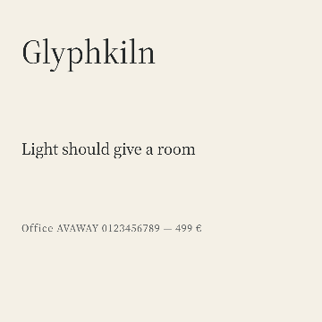         | [full size](../../../packages/glyphkiln-core/tests/visual/m1/specimen-source-serif-4.png)     |
| `specimen-trirong` 1080 × 1080 `b8bd1895406d…`            | Trirong 400 (primary; Latin+Thai)                                                                                                                                          | 360 px: smallest x-height 5.98 px; `CRAFT_DEAD_SPACE:canvas` | 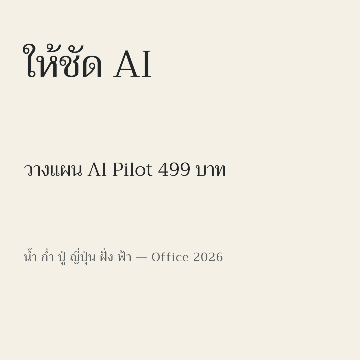                       | [full size](../../../packages/glyphkiln-core/tests/visual/m1/specimen-trirong.png)            |

## Benchmark brief A (GD20 input A) per Thai–Latin pairing, Scene 1.1.0, 1600 × 1600; delivery view 400 × 400

| Baseline                                                       | Faces drawn (manifest font identity v2)                                                                                                                                                                                                                                     | Craft review at delivery width                                                                   | 360 px phone preview                                                             | Master                                                                                       |
| -------------------------------------------------------------- | --------------------------------------------------------------------------------------------------------------------------------------------------------------------------------------------------------------------------------------------------------------------------- | ------------------------------------------------------------------------------------------------ | -------------------------------------------------------------------------------- | -------------------------------------------------------------------------------------------- |
| `brief-a-kanit-barlow` 1600 × 1600 `8def3804ce1e…`       | Kanit 700 (primary; Thai) Barlow Condensed 700 (script:latn, scale 1.051; Latin) Kanit 400 (primary; Thai) Barlow Condensed 400 (script:latn, scale 1.067; Latin)                                                                                                  | 360 px: smallest x-height 5.55 px; no findings 400 px: smallest x-height 6.16 px; no findings | 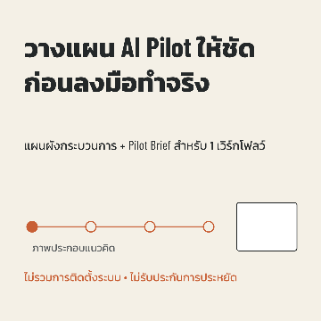             | [full size](../../../packages/glyphkiln-core/tests/visual/m1/brief-a-kanit-barlow.png)       |
| `brief-a-noto-inter` 1600 × 1600 `0649796a8bb4…`         | Noto Sans Thai 700 (primary; wdth 100, wght 700; Thai) Inter 700 (script:latn, scale 1.063; opsz 32, wght 700; Latin) Noto Sans Thai 400 (primary; wdth 100, wght 400; Thai) Inter 400 (script:latn, scale 1.057; opsz 32, wght 400; Latin)                        | 360 px: smallest x-height 6.51 px; no findings 400 px: smallest x-height 7.23 px; no findings | 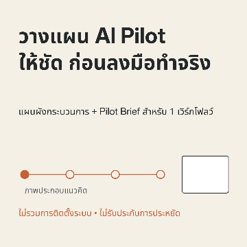                 | [full size](../../../packages/glyphkiln-core/tests/visual/m1/brief-a-noto-inter.png)         |
| `brief-a-noto-serif` 1600 × 1600 `cbdbb3ada8e9…`         | Noto Serif Thai 700 (primary; wdth 100, wght 700; Thai) Source Serif 4 700 (script:latn, scale 1.218; opsz 60, wght 700; Latin) Noto Serif Thai 400 (primary; wdth 100, wght 400; Thai) Source Serif 4 400 (script:latn, scale 1.181; opsz 35.87, wght 400; Latin) | 360 px: smallest x-height 6.27 px; no findings 400 px: smallest x-height 6.97 px; no findings | 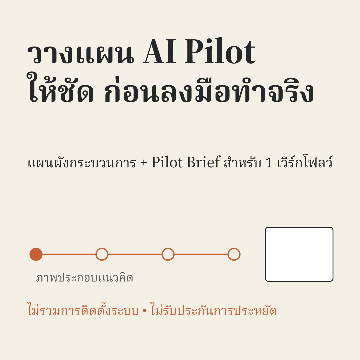                 | [full size](../../../packages/glyphkiln-core/tests/visual/m1/brief-a-noto-serif.png)         |
| `brief-a-plex` 1600 × 1600 `29334bd641aa…`               | IBM Plex Sans Thai 700 (primary; Thai) IBM Plex Sans 700 (script:latn, scale 1.055; wdth 100, wght 700; Latin) IBM Plex Sans Thai 400 (primary; Thai) IBM Plex Sans 400 (script:latn, scale 1.058; wdth 100, wght 400; Latin)                                      | 360 px: smallest x-height 6.04 px; no findings 400 px: smallest x-height 6.71 px; no findings | 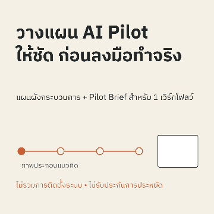                             | [full size](../../../packages/glyphkiln-core/tests/visual/m1/brief-a-plex.png)               |
| `brief-a-sarabun-schibsted` 1600 × 1600 `c3a16f2f0226…`  | Sarabun 700 (primary; Thai) Schibsted Grotesk 700 (script:latn, scale 1.111; wght 700; Latin) Sarabun 400 (primary; Thai) Schibsted Grotesk 400 (script:latn, scale 1.111; wght 400; Latin)                                                                        | 360 px: smallest x-height 5.85 px; no findings 400 px: smallest x-height 6.50 px; no findings |    | [full size](../../../packages/glyphkiln-core/tests/visual/m1/brief-a-sarabun-schibsted.png)  |
| `brief-a-trirong-instrument` 1600 × 1600 `b2d770465803…` | Trirong 400 (primary; Thai) Instrument Serif 400 (script:latn, scale 1.106; Latin)                                                                                                                                                                                       | 360 px: smallest x-height 5.83 px; no findings 400 px: smallest x-height 6.47 px; no findings | 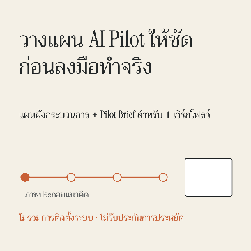 | [full size](../../../packages/glyphkiln-core/tests/visual/m1/brief-a-trirong-instrument.png) |

## Kilnform quote (K2) per pairing on quote-card@1.4.0, Instagram portrait 1080 × 1350; delivery view 360 × 450

| Baseline                                                              | Faces drawn (manifest font identity v2)                                                                            | Craft review at delivery width                                                | 360 px phone preview                                                                           | Master                                                                                              |
| --------------------------------------------------------------------- | ------------------------------------------------------------------------------------------------------------------ | ----------------------------------------------------------------------------- | ---------------------------------------------------------------------------------------------- | --------------------------------------------------------------------------------------------------- |
| `kilnform-quote-kanit-barlow` 1080 × 1350 `764cc26c79fb…`       | Barlow Condensed 700 (primary; Latin) Barlow Condensed 600 (primary; Latin)                                     | 360 px: smallest x-height 5.79 px; no findings                                | 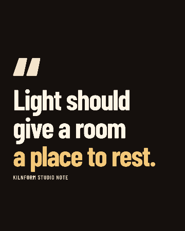             | [full size](../../../packages/glyphkiln-core/tests/visual/m1/kilnform-quote-kanit-barlow.png)       |
| `kilnform-quote-noto-inter` 1080 × 1350 `bfd3a02195a9…`         | Inter 700 (primary; opsz 32, wght 700; Latin) Inter 600 (primary; opsz 25.5, wght 600; Latin)                   | 360 px: smallest x-height 6.19 px; no findings                                | 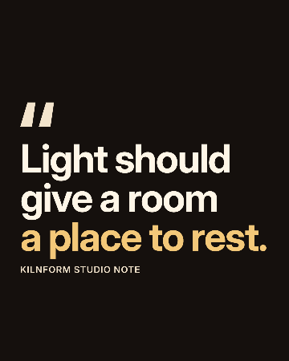                 | [full size](../../../packages/glyphkiln-core/tests/visual/m1/kilnform-quote-noto-inter.png)         |
| `kilnform-quote-noto-serif` 1080 × 1350 `c4899743d0cc…`         | Source Serif 4 700 (primary; opsz 60, wght 700; Latin) Source Serif 4 600 (primary; opsz 25.5, wght 600; Latin) | 360 px: smallest x-height 5.38 px; `CRAFT_TEXT_SMALL_AT_DELIVERY:attribution` | 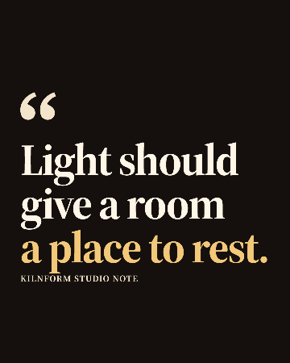                 | [full size](../../../packages/glyphkiln-core/tests/visual/m1/kilnform-quote-noto-serif.png)         |
| `kilnform-quote-plex` 1080 × 1350 `a80228a11824…`               | IBM Plex Sans 700 (primary; wdth 100, wght 700; Latin) IBM Plex Sans 600 (primary; wdth 100, wght 600; Latin)   | 360 px: smallest x-height 5.85 px; no findings                                | 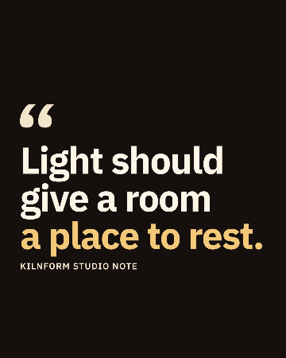                             | [full size](../../../packages/glyphkiln-core/tests/visual/m1/kilnform-quote-plex.png)               |
| `kilnform-quote-sarabun-schibsted` 1080 × 1350 `cf7fc014d35f…`  | Schibsted Grotesk 700 (primary; wght 700; Latin) Schibsted Grotesk 600 (primary; wght 600; Latin)               | 360 px: smallest x-height 5.98 px; no findings                                | 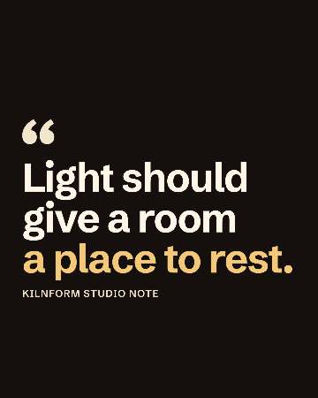   | [full size](../../../packages/glyphkiln-core/tests/visual/m1/kilnform-quote-sarabun-schibsted.png)  |
| `kilnform-quote-trirong-instrument` 1080 × 1350 `09a73a952ed8…` | Instrument Serif 400 (primary; Latin)                                                                              | 360 px: smallest x-height 5.78 px; no findings                                | 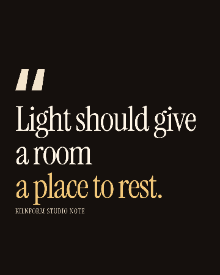 | [full size](../../../packages/glyphkiln-core/tests/visual/m1/kilnform-quote-trirong-instrument.png) |

## New M1 template versions (B2 baselines on schema 1.8.0)

| Baseline                                                         | Faces drawn (manifest font identity v2)                                                                                                                                                           | Craft review at delivery width                                                                                                                                                                 | 360 px phone preview                                                                 | Master                                                                                         |
| ---------------------------------------------------------------- | ------------------------------------------------------------------------------------------------------------------------------------------------------------------------------------------------- | ---------------------------------------------------------------------------------------------------------------------------------------------------------------------------------------------- | ------------------------------------------------------------------------------------ | ---------------------------------------------------------------------------------------------- |
| `image-led-campaign-m1-square` 1080 × 1080 `ed3c5b863017…` | Inter 700 (primary; opsz 16.5, wght 700; Latin) Inter 800 (primary; opsz 32, wght 800; Latin) Inter 400 (primary; opsz 22.5, wght 400; Latin)                                               | 360 px: smallest x-height 4.00 px; `CRAFT_TEXT_SMALL_AT_DELIVERY:eyebrow`, `CRAFT_TEXT_SMALL_AT_DELIVERY:subtitle`, `CRAFT_TEXT_SMALL_AT_DELIVERY:cta`, `CRAFT_MARK_LOW_VISIBILITY:brand-mark` | 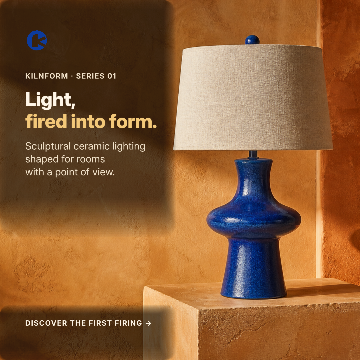 | [full size](../../../packages/glyphkiln-core/tests/visual/m1/image-led-campaign-m1-square.png) |
| `quote-card-m1` 1080 × 1350 `091458f2b95c…`                | Inter 700 (primary; opsz 32, wght 700; Latin) Inter 600 (primary; opsz 25.5, wght 600; Latin)                                                                                                  | 360 px: smallest x-height 6.19 px; no findings                                                                                                                                                 | 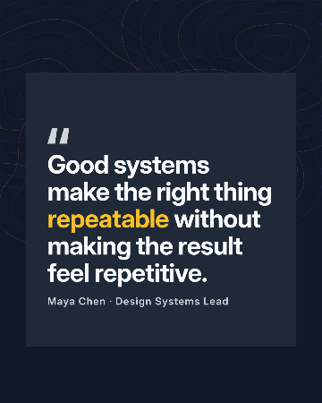                               | [full size](../../../packages/glyphkiln-core/tests/visual/m1/quote-card-m1.png)                |
| `statistic-card-m1` 1080 × 1080 `640a8a5aed3a…`            | Inter 700 (primary; opsz 32, wght 700; Latin) Inter 600 (primary; opsz 27, wght 600; Latin) Inter 800 (primary; opsz 32, wght 800; Common) Inter 500 (primary; opsz 32, wght 500; Latin) | 360 px: smallest x-height 6.55 px; no findings                                                                                                                                                 |                        | [full size](../../../packages/glyphkiln-core/tests/visual/m1/statistic-card-m1.png)            |
